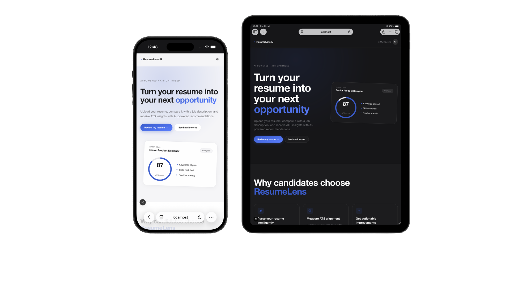
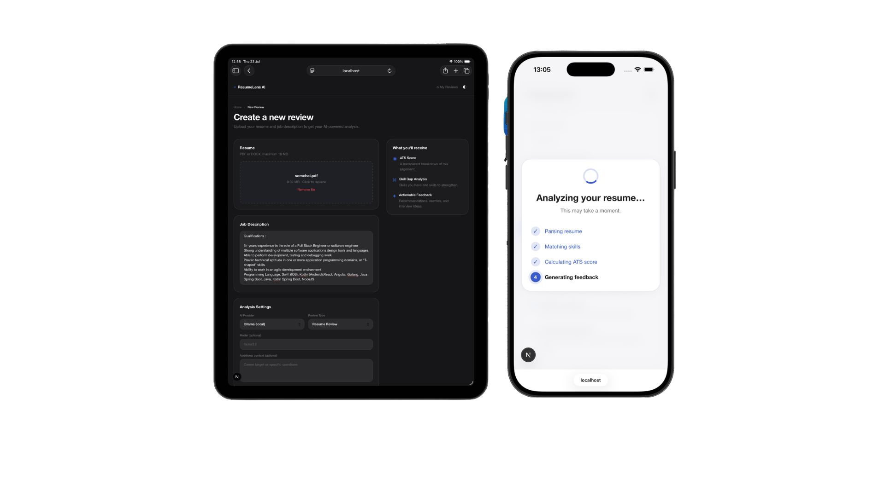
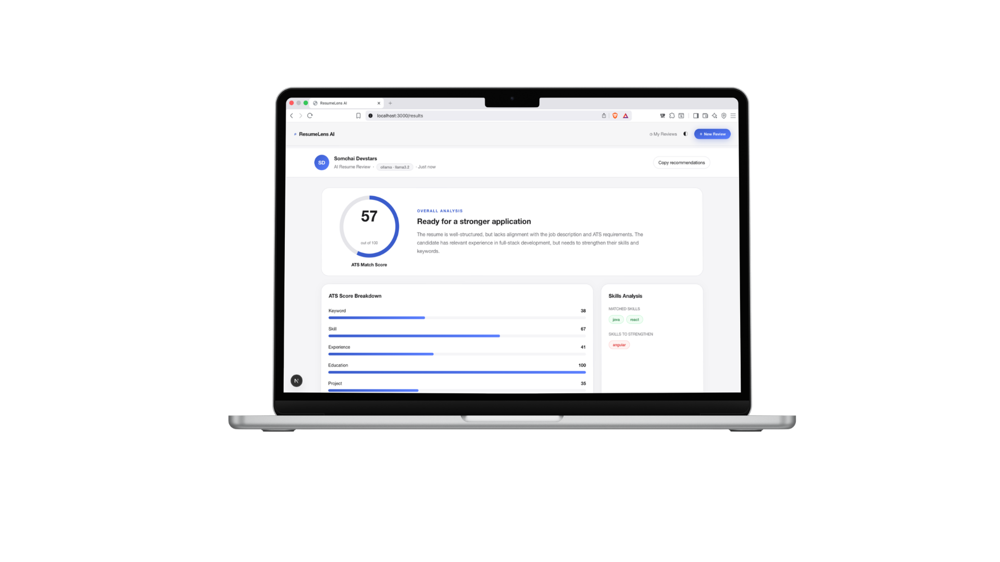
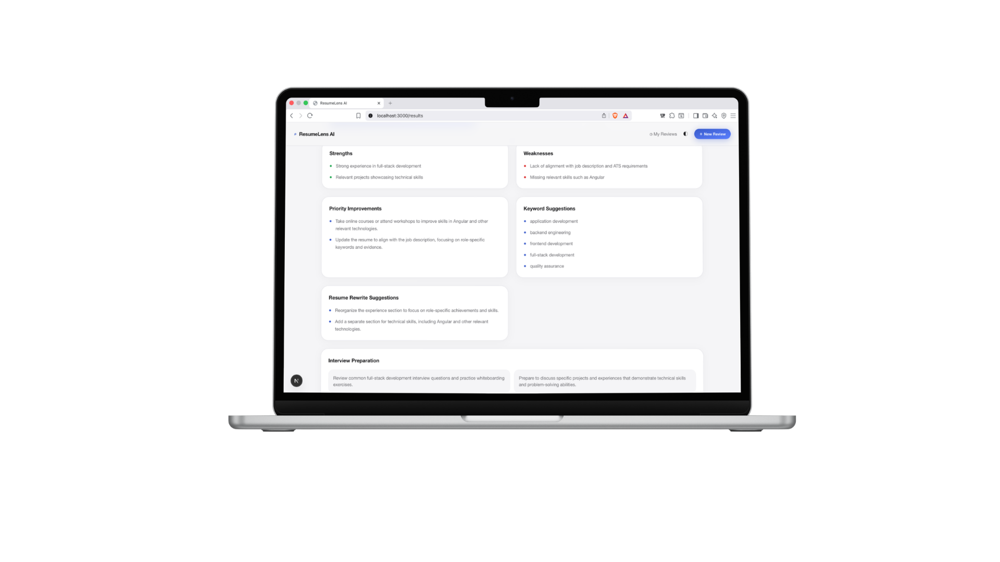

# ResumeLens AI

<div align="center">

<h3>🚀 AI-Powered Resume Reviewer & ATS Optimization Platform</h3>

Analyze resumes, measure ATS compatibility, identify skill gaps, and receive personalized AI feedback to improve your chances of landing interviews.

</div>

---

## ✨ Features

- 📄 Upload PDF/DOCX resumes
- 🤖 AI-powered resume analysis
- 📊 ATS compatibility scoring
- 🎯 Job description matching
- 🔍 Skill gap analysis
- 💡 Resume improvement suggestions
- 📝 Resume rewrite recommendations
- 🔑 Keyword optimization
- 🎤 Interview preparation tips
- 📱 Fully responsive (Desktop, Tablet, Mobile)

---

# Screenshots

## Landing Page

<p align="center">

</p>

---

## Create Review & AI Analysis Progress

<p align="center">

</p>

---

## Resume Analysis Result

<p align="center">

</p>

---

## Resume Analysis Feedback

<p align="center">

</p>

---

# Workflow

```text
Resume Upload
      │
      ▼
Document Validation
      │
      ▼
Resume Parser
      │
      ▼
Resume Normalizer
      │
      ▼
ATS Scoring Engine
      │
      ▼
Prompt Builder
      │
      ▼
AI Provider Layer
      │
      ▼
Response Parser
      │
      ▼
Feedback Formatter
      │
      ▼
Results Dashboard
```

---

# AI Pipeline

```
Resume
    │
    ▼
Resume Parsing
    │
    ▼
Extract Skills
Extract Experience
Extract Education
Extract Projects
    │
    ▼
ATS Score Calculation
    │
    ▼
Compare with Job Description
    │
    ▼
LLM Analysis
    │
    ▼
Feedback Generation
    │
    ▼
Resume Recommendations
```

---

# Tech Stack

## Frontend

- React
- TypeScript
- Vite
- React Router
- TailwindCSS
- Framer Motion

## Backend

- Cloudflare Workers (TypeScript) — production, free tier
- Python FastAPI — optional self-hosted backend
- REST API

## AI

- Google Gemini, Groq, OpenRouter (free tiers)
- Cloudflare Workers AI (Llama 3.3)
- Ollama (self-hosted backend)
- Prompt Engineering
- ATS Scoring Engine

## Database

- PostgreSQL
- Supabase

## File Processing

- PDF Parser
- DOCX Parser

---

# Project Structure

```text
ResumeLens-AI
│
├── frontend/
│   ├── components/
│   ├── pages/
│   ├── hooks/
│   ├── lib/
│   └── assets/
│
├── backend/
│   ├── routes/
│   ├── controllers/
│   ├── services/
│   ├── middleware/
│   └── utils/
│
├── ai/
│   ├── parser/
│   ├── scoring/
│   ├── prompts/
│   ├── providers/
│   └── formatter/
│
└── docs/
    └── images/
```

---

# Analysis Includes

✅ ATS Score

✅ Keyword Match

✅ Skills Match

✅ Experience Evaluation

✅ Education Review

✅ Project Assessment

✅ Resume Strengths

✅ Weaknesses

✅ Missing Skills

✅ Resume Rewrite Suggestions

✅ Interview Preparation

---

# Free Deployment (Cloudflare Workers + Free LLM APIs)

The production setup is free: one Cloudflare Worker serves the static Next.js frontend **and** the
`/api/v1` endpoints (`worker/`), and the LLM is called through free-tier APIs.

```text
Browser ── extracts PDF/DOCX text (unpdf / fflate) ──► Cloudflare Worker (/api/v1/reviews)
                                                       ├─ resume parser + ATS scoring
                                                       └─ LLM: gemini → groq → openrouter → workers-ai
```

Resume text is extracted in the browser so the Worker stays within the free plan's CPU budget.

## Free LLM providers

| Provider | Free quota (approx.) | Secret | Get a key |
|---|---|---|---|
| Google Gemini (`gemini-flash-latest`) | ~15 req/min, ~1,500 req/day | `GEMINI_API_KEY` | https://aistudio.google.com/apikey |
| Groq (`llama-3.3-70b-versatile`) | 30 req/min, ~100K tokens/day | `GROQ_API_KEY` | https://console.groq.com/keys |
| OpenRouter (`:free` models) | ~50 req/day | `OPENROUTER_API_KEY` | https://openrouter.ai/keys |
| Cloudflare Workers AI | 10,000 neurons/day (~30 reviews) | none (binding) | built into your Cloudflare account |

Quotas change often; check each provider's console. With `AI_PROVIDER=auto` (default) the Worker
tries every configured provider in that order, so when one free quota runs out (HTTP 429) the next
one answers. Workers AI needs no key, so the app works even before you add any secret.

## Deploy with Wrangler

```bash
cd worker
npm install
npx wrangler login                      # opens the browser; a free Cloudflare account is enough

# optional but recommended: add one or more free API keys
npx wrangler secret put GEMINI_API_KEY
npx wrangler secret put GROQ_API_KEY
npx wrangler secret put OPENROUTER_API_KEY

npm run deploy                          # builds frontend/out, then `wrangler deploy`
```

Wrangler prints the URL, e.g. `https://resumelens-ai.<your-subdomain>.workers.dev`.

Optional settings (`worker/wrangler.jsonc` → `vars`, or `wrangler secret put`): `AI_PROVIDER`
(`auto`, `gemini`, `groq`, `openrouter`, `workers-ai`), `GEMINI_MODEL`, `GROQ_MODEL`,
`OPENROUTER_MODEL`, `WORKERS_AI_MODEL`, `ALLOWED_ORIGINS` (CORS for local `next dev`).

### Automatic deploys from GitHub (optional)

`.github/workflows/cloudflare.yml` runs the tests on every PR and deploys on push to `main` once the
repository has the secrets `CLOUDFLARE_API_TOKEN` (template "Edit Cloudflare Workers") and
`CLOUDFLARE_ACCOUNT_ID`. LLM keys stay in Cloudflare (`wrangler secret put`), not in GitHub.

## Local development

```bash
cd worker
cp .dev.vars.example .dev.vars          # add your free API keys here (never commit it)
npm run build:frontend && npm run dev   # http://localhost:8787 (frontend + API)
npm test                                # worker unit tests
```

The Workers AI binding talks to Cloudflare even in `wrangler dev`, so run `npx wrangler login` first.
For frontend hot reload, run `npm run dev` in `frontend/` with
`NEXT_PUBLIC_API_BASE_URL=http://localhost:8787`.

The original Python FastAPI backend (`backend/`) still works for self-hosting (e.g. with Ollama);
see `backend/README.md`.

---

# คู่มือภาษาไทย: Deploy ฟรีด้วย Cloudflare Wrangler

1. สมัคร Cloudflare (ฟรี) แล้วสมัคร API key ฟรีอย่างน้อย 1 เจ้า เช่น Gemini (aistudio.google.com/apikey) หรือ Groq (console.groq.com/keys)
2. รันคำสั่ง
   ```bash
   cd worker
   npm install
   npx wrangler login
   npx wrangler secret put GEMINI_API_KEY   # วาง key เมื่อถูกถาม (ใส่ GROQ_API_KEY เพิ่มเป็นตัวสำรองได้)
   npm run deploy
   ```
3. เปิด URL `https://resumelens-ai.<subdomain>.workers.dev` ที่ Wrangler แสดง

ค่าเริ่มต้นคือ `AI_PROVIDER=auto` ระบบจะไล่ใช้ Gemini → Groq → OpenRouter → Workers AI ตามที่ตั้งค่าไว้
ถ้าโควต้าฟรีของเจ้าหนึ่งหมด ระบบจะสลับไปเจ้าถัดไปเอง และ Workers AI ใช้ได้ทันทีโดยไม่ต้องมี key (ฟรีวันละ 10,000 neurons)

---

# Future Improvements

- [ ] Multi-language resume support
- [ ] Resume templates
- [ ] Cover letter generation
- [ ] Interview simulation
- [ ] AI career roadmap
- [ ] LinkedIn profile analysis
- [ ] Recruiter dashboard
- [ ] Resume version history

---

# Roadmap

- Resume Parser
- ATS Engine
- AI Feedback
- Job Matching
- Cover Letter AI
- Interview Coach
- Career Advisor

---

# Contributing

Contributions are welcome.

1. Fork the project
2. Create a feature branch

```bash
git checkout -b feature/my-feature
```

3. Commit changes

```bash
git commit -m "Add new feature"
```

4. Push

```bash
git push origin feature/my-feature
```

5. Open a Pull Request

---

# License

MIT License

---

<div align="center">

Made with ❤️ using React, TypeScript, Ollama and AI

**ResumeLens AI**

</div>
